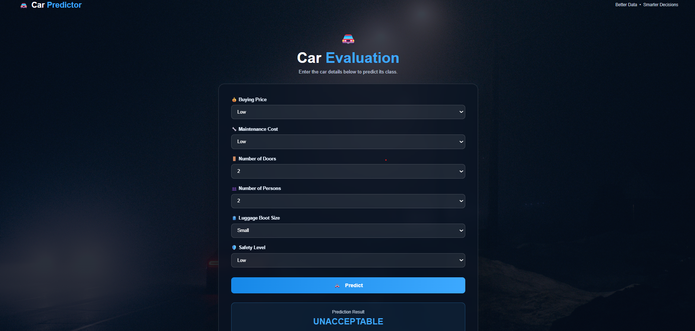

# Car Evaluation ML Website

A Django-based web application that uses a machine learning model to predict the evaluation of a car based on user-provided features.

## Project Overview

This project integrates a machine learning model into a Django web application. Users can enter different car features through a web interface, and the trained machine learning model predicts the car's evaluation category.

The machine learning model was trained using the **Car Evaluation dataset** and saved as a `.pkl` file. Django loads the trained model and uses it to make predictions based on the user's input.

## Screenshot



## Features

* User-friendly web interface
* Car evaluation prediction using a trained machine learning model
* Django backend
* Machine learning model integrated with Django
* Static CSS styling
* Responsive car-themed interface

## Technologies Used

* **Python**
* **Django**
* **Scikit-learn**
* **HTML5**
* **CSS3**
* **Pickle**
* **Git & GitHub**

## Machine Learning Model

This project uses a **Decision Tree Classifier** for car evaluation prediction.

The model was trained using the **Car Evaluation dataset** and saved using Python's `pickle` module.

The trained model is stored in:

```text
car_evaluation_model.pkl
```

### Input Features

The model uses the following features:

* Buying price
* Maintenance price
* Number of doors
* Number of persons
* Luggage boot size
* Safety level

### Prediction

The model predicts the car's evaluation category based on the provided features.

The possible evaluation categories in the Car Evaluation dataset are:

* Unacceptable
* Acceptable
* Good
* Very Good

## Dataset

The machine learning model was trained using the **Car Evaluation dataset**.

The dataset contains information about cars based on:

* Buying price
* Maintenance cost
* Number of doors
* Passenger capacity
* Luggage boot size
* Safety level

These features are used to determine the overall evaluation of a car.

## Machine Learning Workflow

The machine learning workflow used for this project is:

```text
Car Evaluation Dataset
          ↓
Data Preprocessing
          ↓
Feature Encoding
          ↓
Train/Test Split
          ↓
Decision Tree Classifier
          ↓
Model Evaluation
          ↓
Save Trained Model
          ↓
Django Integration
          ↓
Car Evaluation Prediction
```

## Project Structure

```text
car_ml_website/
│
├── car_website/
│   ├── car_website/
│   │   ├── __init__.py
│   │   ├── settings.py
│   │   ├── urls.py
│   │   ├── asgi.py
│   │   └── wsgi.py
│   │
│   ├── predictor/
│   │   ├── migrations/
│   │   ├── static/
│   │   │   └── predictor/
│   │   │       ├── images/
│   │   │       └── style.css
│   │   ├── templates/
│   │   │   └── predictor/
│   │   │       └── home.html
│   │   ├── admin.py
│   │   ├── apps.py
│   │   ├── models.py
│   │   ├── tests.py
│   │   └── views.py
│   │
│   ├── car_evaluation_model.pkl
│   ├── manage.py
│   └── .gitignore
│
└── README.md
```

## Installation and Setup

### 1. Clone the repository

```bash
git clone https://github.com/ShahoodAhmad16/car-ml-website.git
```

Replace `YOUR-USERNAME` with your GitHub username.

### 2. Open the project folder

```bash
cd car-ml-website
```

Then enter the Django project directory:

```bash
cd car_website
```

### 3. Create a virtual environment

```bash
python -m venv venv
```

### 4. Activate the virtual environment

On Windows:

```bash
venv\Scripts\activate
```

### 5. Install the required packages

```bash
pip install django scikit-learn
```

### 6. Run database migrations

```bash
python manage.py migrate
```

### 7. Start the Django development server

```bash
python manage.py runserver
```

Open the address shown in the terminal, usually:

```text
http://127.0.0.1:8000/
```

## How It Works

The application follows this process:

```text
User enters car information
          ↓
      Django View
          ↓
   Feature Processing
          ↓
Decision Tree Classifier
          ↓
    Prediction Result
          ↓
      Web Interface
```

The Django view receives the user's input, prepares the features in the format expected by the trained model, loads `car_evaluation_model.pkl`, and generates the prediction.

## Model File

The trained Decision Tree model is included in this repository:

```text
car_evaluation_model.pkl
```

The file is small enough to be stored directly in the GitHub repository.

## Future Improvements

Possible improvements include:

* Deploying the application online
* Improving the user interface
* Adding prediction history
* Adding model performance information
* Adding additional machine learning models
* Improving mobile responsiveness

## Author

**Shahood Ahmad**

This project was developed as a Django-based machine learning web application.
